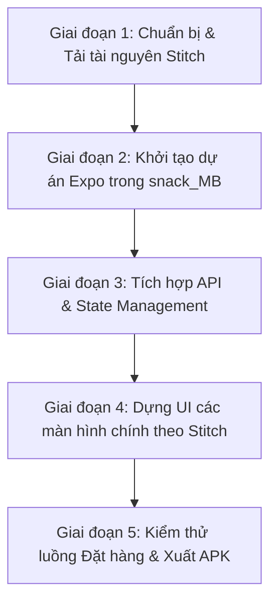

# 📱 Kế hoạch Triển khai Ứng dụng Di động SnackShop (`snack_MB`)

> **Mục tiêu**: Xây dựng ứng dụng di động Android (xuất file `.apk`) cho dự án **SnackShop** dựa trên bộ thiết kế UI/UX từ **Google Stitch (Project ID: `17509700448297251377`)**, kết nối trực tiếp với hệ thống Backend ASP.NET Core Web API hiện có.

---

## 🎨 1. Dữ liệu Thiết kế từ Google Stitch

Dự án Stitch đã trích xuất thành công 5 màn hình chuẩn hóa:

| STT | Màn hình | Stitch Screen ID | Chức năng chính |
| :---: | :--- | :--- | :--- |
| **1** | **Trang chủ (Home Screen)** | `cfe3c3d2f7c644fe951cf63cce351616` | Banner ưu đãi, danh mục ăn vặt, flash deals, món bán chạy, nút thêm nhanh |
| **2** | **Chi tiết món ăn (Product Detail)** | `4270f63a5f0a4beea192000e68c7f6e4` | Carousel ảnh món, **ô chọn trọng lượng (150g/300g/500g)**, tình trạng kho, đánh giá |
| **3** | **Giỏ hàng & Đặt hàng (Cart & Checkout)** | `e64a945ec0884d66a29037aa2c2082ba` | Danh sách món trong giỏ, áp mã voucher, chọn địa chỉ & phương thức thanh toán |
| **4** | **Theo dõi đơn hàng (Order Tracking)** | `3a2368fe2db341ee8e905a3291a3aaba` | Timeline tiến trình giao hàng (Chờ xác nhận ➔ Đang giao ➔ Hoàn thành), liên hệ Shipper |
| **5** | **Trung tâm thông báo (Notification Center)** | `f390ec16145542c383eee76849053a52` | Tab Tất cả / Chưa đọc, badge số lượng chưa đọc, phân loại thông báo đơn hàng/ưu đãi |

### Design System Tokens (Stitch):
- **Primary Color**: `#F97316` ➔ `#EA580C` (Cam rực rỡ)
- **Secondary / Accent**: `#F59E0B` (Vàng phô mai), `#EF4444` (Đỏ ớt cay)
- **Background**: `#FFFAF5` ➔ `#FFFFFF` (Kem ấm áp)
- **Typography**: Plus Jakarta Sans
- **Radius**: `16px` - `24px` (Bo tròn hiện đại, thân thiện)

---

## 🏗️ 2. Kiến trúc & Công nghệ Đề xuất

- **Framework**: **React Native** với **Expo (SDK 52+)**
  - Quản lý điều hướng: `expo-router` hoặc `@react-navigation/native`
  - Quản lý State & Cache: `@tanstack/react-query` & `zustand` (tái sử dụng hoàn toàn logic từ web `Snack_WA`)
  - HTTP Client: `axios` cấu hình endpoint Android (`http://10.0.2.2:5000` cho máy ảo hoặc IP LAN cho máy thật)
  - Lưu trữ phiên đăng nhập: `expo-secure-store` hoặc `@react-native-async-storage/async-storage`
  - UI Icons: `@expo/vector-icons` (Ionicons, MaterialCommunityIcons, Feather)
- **Cấu trúc thư mục tại `d:\Snack_Shop\snack_MB`**:
  ```text
  snack_MB/
  ├── assets/                # Logo, icon app, splash screen
  ├── stitch_design/         # File HTML & Screenshots tải về từ Stitch tham chiếu
  ├── src/
  │   ├── api/               # Axios client kết nối backend SnackShop.API
  │   ├── constants/         # Theme colors, fonts, orderStatus, roles
  │   ├── components/        # UI Atoms: ProductCard, VariantSelector, Stepper, HeaderBar, Badge
  │   ├── hooks/             # React Query hooks (useProducts, useCart, useOrders, useNotifications)
  │   ├── store/             # Zustand authStore (JWT token, user profile)
  │   ├── navigation/        # BottomTabNavigator & RootStackNavigator
  │   └── screens/
  │       ├── auth/          # LoginScreen, RegisterScreen
  │       ├── home/          # HomeScreen
  │       ├── product/       # ProductDetailScreen (với 3 ô chọn khối lượng)
  │       ├── cart/          # CartScreen, CheckoutScreen
  │       ├── orders/        # OrderListScreen, OrderTrackingScreen
  │       ├── notifications/ # NotificationScreen
  │       └── profile/       # ProfileScreen
  ├── app.json               # Cấu hình Expo Android package, permissions
  └── package.json
  ```

---

## 🚀 3. Lộ trình Thực hiện theo Giai đoạn (Roadmap)



### Chi tiết các bước thực hiện:

#### 🔹 Giai đoạn 1: Tải và lưu trữ tài nguyên Stitch
1. Tạo thư mục `d:\Snack_Shop\snack_MB\stitch_design`.
2. Tải mã nguồn HTML giao diện mẫu và ảnh chụp màn hình (Screenshots) của cả 5 màn hình Stitch về lưu trữ cục bộ để làm kim chỉ nam thiết kế.

#### 🔹 Giai đoạn 2: Khởi tạo dự án Mobile
1. Khởi tạo dự án React Native Expo bên trong thư mục `d:\Snack_Shop\snack_MB`.
2. Cài đặt các thư viện thiết yếu:
   - `@react-navigation/native`, `@react-navigation/bottom-tabs`, `@react-navigation/native-stack`
   - `react-native-screens`, `react-native-safe-area-context`
   - `@tanstack/react-query`, `zustand`, `axios`
   - `expo-secure-store`, `@expo/vector-icons`, `expo-linear-gradient`

#### 🔹 Giai đoạn 3: Kết nối API & Xác thực người dùng
1. Xây dựng `apiClient.js` tự động nhận diện IP backend `.NET 8` trên cổng 5000.
2. Thiết lập `authStore` lưu trữ Token, tự động đăng nhập khi mở app.
3. Chuyển giao các hook `useProducts`, `useProduct(id)`, `useCart`, `useOrders`, `useNotifications` từ web sang mobile.

#### 🔹 Giai đoạn 4: Code UI các màn hình theo đúng bản thiết kế Stitch
1. **HomeScreen**: Thanh tìm kiếm ăn vặt, banner khuyến mãi, danh mục món, danh sách món kèm nút thêm nhanh `+`.
2. **ProductDetailScreen**: Hiển thị ảnh lớn, giá tiền, **bộ 3 ô chọn khối lượng (150g, 300g, 500g)** cập nhật giá và tồn kho tức thời.
3. **Cart & CheckoutScreen**: Tăng giảm số lượng, nhập mã voucher, chọn địa chỉ và thanh toán.
4. **OrderTrackingScreen**: Thanh tiến độ trạng thái đơn hàng (Timeline) từ Chờ xác nhận ➔ Đang giao ➔ Hoàn thành.
5. **NotificationScreen**: Hiển thị danh sách thông báo đơn hàng và nút "Đánh dấu đã đọc tất cả".

#### 🔹 Giai đoạn 5: Đóng gói & Xuất file APK Android
1. Cấu hình `eas.json` và `app.json` cho Android (Package name: `com.snackshop.app`).
2. Build kiểm thử local bằng Expo Go trên thiết bị Android thật / máy ảo.
3. Xuất file cài đặt `.apk` độc lập (Standalone APK Preview) sẵn sàng cài vào điện thoại.
